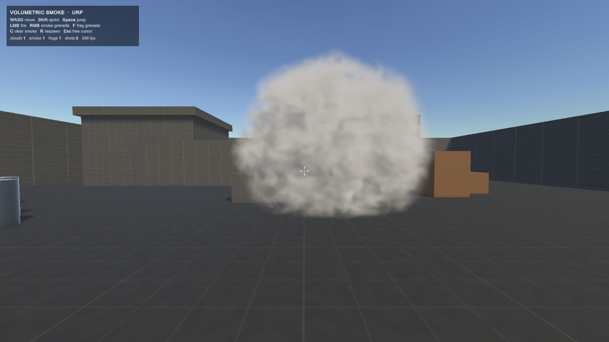
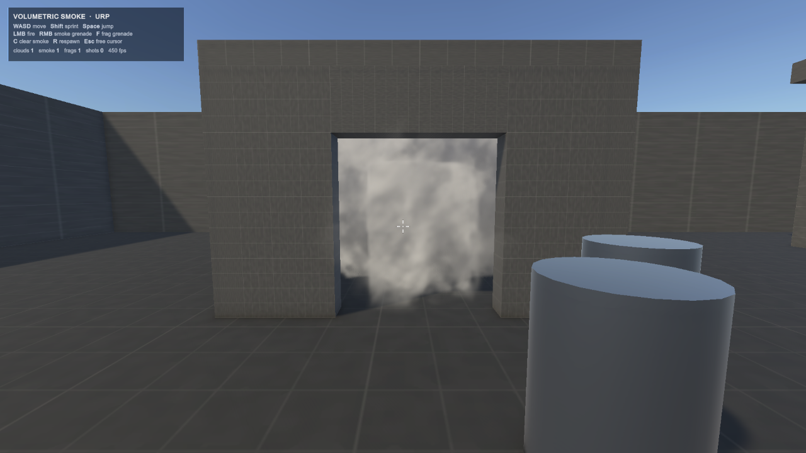

# 仿 CS2 体积烟雾弹（Unity URP）

一个在 Unity URP 下实现的**真体积烟雾** Demo：解析式球体 ray-march + 3D 噪声密度场 +
主光散射 / 自阴影 + 基于深度图的正确遮挡裁剪。附带一个可以直接开玩的第一人称场景。

不是 billboard、不是贴图序列帧，是对密度场做沿视线的光学厚度积分。



除了"看起来像烟"，这一版还让烟**参与场景**：

- **贴墙、绕墙、从门里灌进去**：每颗烟团爆开时会烘焙一张场景距离场，烟只能沿自由空间扩散，
  于是会被墙挡住、贴着墙铺开，并顺着唯一的门洞涌进房间。
- **能被打穿**：子弹在烟里留下一条存在约 1 秒的隧道，然后慢慢愈合。
- **能被炸开**：手雷的爆点会在烟里炸出一个洞，同时把整团烟向外推一把。
- **在空中炸开**：烟雾弹按抛物线飞向准星指向的位置，引信时间等于飞行时间，
  所以它会在半空中、离投掷点几米远的地方起烟，而不是落地滚一段再冒烟。



## 环境要求

| 项 | 版本 |
| --- | --- |
| Unity | 6000.5.6f1（Unity 6.1 及以上均可） |
| URP | 17.5.0 |
| Input System | 1.20.0 |

URP Asset（`Assets/Settings/PC_RPAsset.asset`）里的 **Depth Texture 必须开启**，
体积积分靠它把射线裁剪到不透明表面处。

## 快速开始

1. 用 Unity Hub 打开本工程目录
2. 打开场景 `Assets/SmokeVolumetric/Scenes/SmokeDemo.unity`
3. 点 **Play**

一开始会锁定鼠标；按 `Esc` 释放，点击画面重新锁定。

## 操作

| 输入 | 作用 |
| --- | --- |
| `WASD` | 移动 |
| `Shift` | 冲刺 |
| `Space` | 跳 |
| 鼠标 | 视角 |
| **左键** | 开枪（在烟里打出隧道） |
| **右键** | 投掷烟雾弹（飞向准星，空中起烟） |
| **`F`** | 投掷破片手雷（炸开烟团） |
| `C` | 清除所有烟 |
| `R` | 回到出生点 |
| `Esc` | 释放/锁定鼠标 |

场景里放了几组掩体（矮墙、箱子、塔楼、建筑），用来观察烟和几何体的正确遮挡关系：
烟只在几何体**后面**的部分被绘制，贴在墙前、绕到墙后都会正确分层。

场地左侧有一间 5×5×3.2 m 的 **SmokeRoom**，只有一扇 2.2 m 宽的门。对着门里扔一颗烟，
能看到烟被四面墙和屋顶关住，然后从门洞往外溢出来。这是纯球体烟做不到的事。

## 烟和场景的交互

**场景体素场**（`Scripts/SmokeField.cs`）

只靠噪声是长不出"被墙挡住"的形状的，所以每颗烟团爆开时会把周围的静态几何体
体素化（0.4 m 一格），并为它生成一张 3D 纹理，每个格子里存两个量：

| 通道 | 含义 |
| --- | --- |
| `R` | 到最近实体格的距离（0 = 贴着墙，1.2 m 以上饱和） |
| `G` | 从爆点出发、**只经过自由空间**的最短路径长度（6 m 以上饱和） |

着色器用这两个量给密度加门：

- `R` 让烟在墙面附近淡出，接触面不会出现硬边；
- `G` 是"扩散前沿"。墙会把 `G` 抬高（烟过不去），门洞不会（烟能灌进去），
  所以烟的形状是**沿场景长出来的**，而不是一个可以穿墙的球。

`G` 用的是两遍扫描的 **26 邻域 chamfer 距离变换**。第一版用的是 6 邻域 BFS，
它的距离度量是曼哈顿距离，会把烟的轮廓切成一个八面体；换成带对角线权重的 chamfer 之后
既保留了"绕墙走"的性质，轮廓又恢复成圆的一团。

体素场在爆炸瞬间烘焙一次（`SmokeField.BuildReach`），之后是只读的 3D 纹理，
每帧的开销只有一次采样。

**子弹和爆炸**（`Scripts/SmokeImpulses.cs`）

烟团不接受物理碰撞，所以弹孔和弹坑做成了一组**全局胶囊体**（最多 8 个）：
`_ImpulseA` / `_ImpulseB` / `_ImpulseCount` 三个 shader global，
每帧从 C# 重新推一遍，寿命到了就自己愈合。

- 开枪：沿子弹方向塞一根细胶囊，半径 0.30 m、寿命 1.1 s；前 1/3 寿命洞是全开的，
  之后按 smoothstep 收口，于是能看到隧道慢慢合拢。
- 手雷：在爆点塞一个球形胶囊（半径 4.6 m、寿命 1.1 s），同时
  `SmokeVolume.Blast` 把附近烟团的半径向外推，烟会先被炸开再慢慢回填。

**抛物线投掷**（`Scripts/Ballistics.cs`、`SmokeGrenade.cs`、`FragGrenade.cs`）

投掷时先解出落点：从相机发出的射线打到什么就在那里炸（打中烟时用解析球求交，
炸在烟的近表面，否则爆点会被几米厚的烟挡住看不见），最低离地 1.5 m。
然后按重力反解初速度，让飞行时间正好等于引信时间——所以它总是**在空中、
准星指的地方**炸开。飞行途中撞到东西也会提前引爆。

## 效果参数

材质在 `Assets/SmokeVolumetric/Resources/SmokeVolume.mat`（运行时由 `Resources.Load` 读取）。

| 参数 | 当前值 | 含义 |
| --- | --- | --- |
| `_Density` | 5.0 | 整体密度。最直观的"烟有多浓" |
| `_Absorption` | 1.45 | 消光系数，和 `_Density` 相乘得到 sigmaT |
| `_NoiseScale` | 1.05 | 噪声频率，越大团块越碎 |
| `_EdgeSoftness` | 0.42 | 轮廓软硬，越小边缘越硬 |
| `_StepCount` | 80 | 单条射线步数，性能/质量的主要开关 |
| `_ShadowStrength` | 1.05 | 自阴影强度 |
| `_AmbientStrength` | 1.25 | 环境光贡献 |
| `_PhaseG` | 0.42 | HG 相函数前向散射强度 |

调参时的经验：`_Density` 和 `_Absorption` 的乘积决定光学厚度。这个乘积要足够大，
保证站在烟里时视线在 0.3~0.5 m 内就衰减到接近全黑（否则墙和箱子会从烟里透出来，
一眼就穿帮）；烟内部的层次则靠**着色**而不是靠"降低密度"来做：云内归一化高度决定
环境光梯度，亚米级噪声只调制散射亮度、并且有下限 clamp，绝不把消光打开通道。
消散阶段由 `_Fade` 同时驱动"侵蚀成丝"和"整体变薄"，所以最后几秒是逐渐消散而不是
整团突然消失。

## 生命周期

`SmokeVolume` 上的公开字段可以按需改：

| 字段 | 值 |
| --- | --- |
| `maxRadius` | 4.2 m |
| `lifetime` | 18 s |
| `expandTime` | 1.25 s |
| `fadeTime` | 3.5 s |
| `startRadius` | 0.55 m |

爆开 → 1.25 s 内膨胀到最大半径 → 缓慢上浮 → 最后 3.5 s 由 `_Fade` 驱动**侵蚀消散**
（密度场被逐渐掏空成丝状残烟），而不是整体变透明。

## 实现要点

**渲染**（`Shaders/SmokeVolume.shader`）

- 用球体网格做代理，`Cull Front` 保证相机进入烟内部时仍然有像素参与绘制
- `ZTest Always` + `ZWrite Off`，真正的遮挡交给深度纹理判断
- 片元里解析求交得到 `[t0, t1]`，再用 `_CameraDepthTexture` 换算的视线距离裁剪 `t1`
- 沿射线采样密度场，累积 `T *= exp(-sigma*step)`，输出 **预乘 alpha**
  （`Blend One OneMinusSrcAlpha`）
- 密度 = 内实核心 + 噪声外鞘，再乘上场景场的接触淡出 / 扩散前沿门控和胶囊体弹孔
- 光照：主光 + Henyey-Greenstein 相函数 + 3 次朝光源的密度采样做自阴影 +
  多次散射近似 + 球谐环境光
- 步长自适应：密度低的地方走大步，靠近烟心再细分；配合交错梯度噪声抖动采样起点，
  消除层状切片

**密度场**（`Scripts/SmokeNoise.cs`）

- 64³ 可平铺 R8 3D 纹理，三个八度的 value noise，**纯 C# 运行时生成**，
  仓库里不需要任何二进制噪声资源
- `_Age` 驱动涡流 warp 和上浮，所以烟雾在掉帧的机器上也是连续演化的

**交互**（`Scripts/FpsPlayer.cs`、`Scripts/Weapon.cs`）

- `CharacterController` 第一人称，带冲刺、跳跃、走路镜头晃动、爆炸震屏
- Input System 直接轮询 `Keyboard.current` / `Mouse.current`，不需要 `.inputactions` 资源
- 手雷是刚体抛射物，飞行时间由弹道解算得出

## 目录结构

```
Assets/SmokeVolumetric/
├── Shaders/SmokeVolume.shader   # 体积 ray-march + 场景场 + 弹孔
├── Scripts/
│   ├── SmokeNoise.cs            # 程序化 3D 噪声
│   ├── SmokeField.cs            # 场景体素化 + chamfer 扩散场
│   ├── SmokeImpulses.cs         # 全局胶囊弹孔 / 弹坑
│   ├── SmokeVolume.cs           # 单个烟团：生命周期 + 参数推送
│   ├── SmokeFx.cs               # 爆炸闪光 / 震屏
│   ├── Ballistics.cs            # 抛物线初速度解算
│   ├── SmokeGrenade.cs          # 烟雾弹：空中起烟
│   ├── FragGrenade.cs           # 破片手雷：炸开烟团
│   ├── Weapon.cs                # 命中扫描 + 烟内弹道
│   ├── FpsPlayer.cs             # 第一人称控制
│   ├── DemoHud.cs               # IMGUI 准星与状态
│   └── SmokeDemoBootstrap.cs    # 后台运行设置
├── Editor/SmokeDemoBuilder.cs   # 用代码生成整个演示场景
├── Resources/SmokeVolume.mat
├── Scenes/SmokeDemo.unity
├── Textures/SmokeDemo_Grid.png
└── Materials/                   # 场景用的 Lit 材质
```

## 关于场景生成

演示场景不是手搭的，而是由 `Editor/SmokeDemoBuilder.cs` 用代码生成（40×40 场地、
掩体、SmokeRoom、光照、天空盒、玩家、HUD），这样仓库里没有易碎的手工引用。

开发期通过 Unity 的 `com.unity.pipeline` 实验包暴露了两个命令：

```
unity command smoke_demo_build   # 重建并保存 SmokeDemo.unity
unity command smoke_preview      # 在 Scene 视图交叉点生成一朵预览烟
```

**如果你不想保留这个实验包依赖**：删掉 `Editor/SmokeDemoBuilder.cs` 顶部的
`using Unity.Pipeline.Commands;` 和文件里两处 `[CliCommand(...)]` 即可。
场景文件已经提交，运行时完全不需要这个包。

## 性能

1280×720 下：看向烟外约 300–500 fps，整个屏幕被烟填满时约 150 fps
（测试机为桌面独显）。想更快就把 `_StepCount` 从 80 降到 48，视觉差异很小；
烟雾的渲染开销几乎全部来自步数 × 每步 4 次 3D 纹理采样（1 次密度 + 3 次自阴影），
再加上一次场景场采样。

## 许可

本项目仅用于学习和演示，与 Valve / Counter-Strike 无关。
