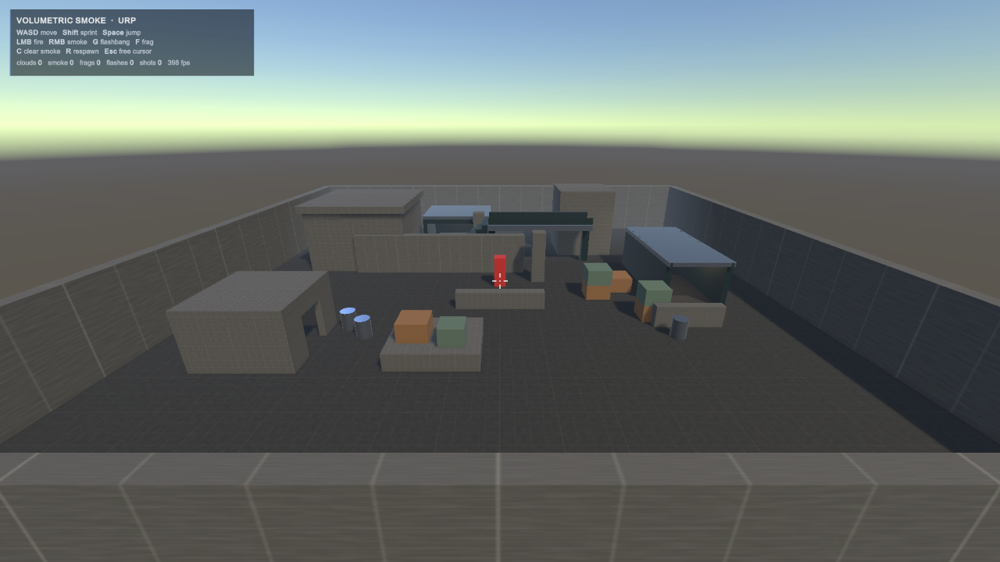
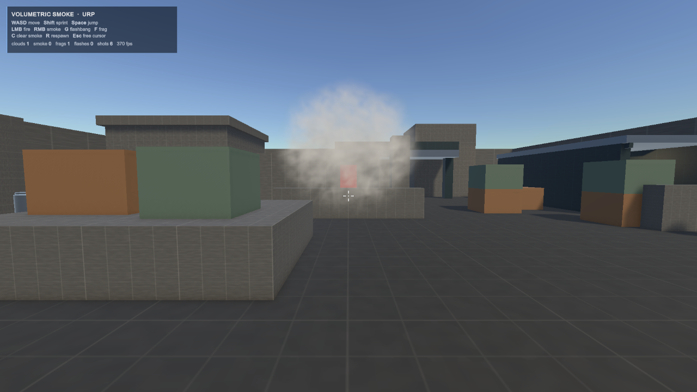
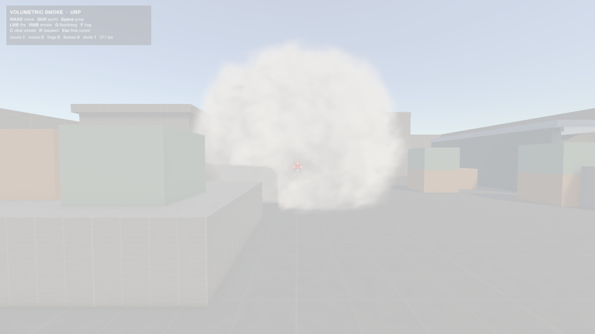

# 技术说明 · Volumetric Smoke (URP)

这份文档写实现细节：渲染、密度场、场景体素场、弹孔、爆炸、闪光弹、弹道和演示场景。
想快速跑起来只看根目录的 [README](../README.md) 就够了。

- [1. 渲染管线](#1-渲染管线)
- [2. 密度场与时间演化](#2-密度场与时间演化)
- [3. 烟与场景：SmokeField](#3-烟与场景smokefield)
- [4. 弹孔与弹坑：SmokeImpulses](#4-弹孔与弹坑smokeimpulses)
- [5. 爆炸：消散而不是膨胀](#5-爆炸消散而不是膨胀)
- [6. 破片手雷 vs 闪光弹](#6-破片手雷-vs-闪光弹)
- [7. 投掷弹道](#7-投掷弹道)
- [8. 演示场景](#8-演示场景)
- [9. 参数速查](#9-参数速查)
- [10. 性能](#10-性能)
- [11. 已知限制](#11-已知限制)

---

## 1. 渲染管线

核心文件：`Assets/SmokeVolumetric/Shaders/SmokeVolume.shader`、`Scripts/SmokeVolume.cs`。

### 1.1 代理球与解析求交

每颗烟是一个缩放过的球体网格（`localScale = 2 × radius`），材质用
`Cull Front`、`ZWrite Off`、`Blend One OneMinusSrcAlpha`。

片元里先对**代理球**做解析求交，得到进入/离开距离 `[t0, t1]`，
再沿这条线段累积光学厚度。这样做的原因：

- 球体只负责"可能有烟的区间"，真正的形状由密度场决定，所以球的轮廓不会露出来；
- 相机进入烟团时 `Cull Front` 仍然有像素参与，不会整团消失；
- 解析求交比全屏后处理便宜，且能精确裁剪到单颗烟的生命周期。

### 1.2 深度裁剪与合成

用 `_CameraDepthTexture` 还原当前像素的不透明表面距离 `tScene`，把 `t1` 裁到 `tScene`：

```
t1 = min(t1, tScene)
```

于是墙、箱子、地板会正确挡住烟；烟在几何体前面时也不会被误裁。
输出是**预乘 alpha**（`rgb = scatter * alpha`），所以跟场景里其他透明物件
（曳光弹、粒子）能正常混合。

### 1.3 步进、抖动与性能

- 步数由 `_StepCount` 控制，材质里是 **80**。
- 步长自适应：密度低的地方走大步，靠近烟心再细分。
- 采样起点用交错梯度噪声抖动，消除层状切片；抖动幅度不超过一个步长，所以不会闪烁。
- 每步的采样：1 次密度 + 3 次朝光源的密度（自阴影）+ 1 次场景场；这些是主要开销。

### 1.4 光照

- **主光**：方向光方向 + Henyey-Greenstein 相函数（`_PhaseG = 0.42`），前向散射明显。
- **自阴影**：沿主光方向再采 3 个密度点，近似 Beer-Lambert 透射。
- **多次散射近似**：在自阴影结果上叠一个与密度相关的环境项，避免背光面死黑。
- **球谐环境光**：用 `ShadeSH9` 取环境色，再乘 `_AmbientStrength`。
- 云内的层次靠**着色**而不是降低密度：归一化高度决定环境光梯度，亚米级噪声只调制散射亮度，
  并带下限 clamp，绝不把消光打开通道（否则箱子会从烟里透出来）。

---

## 2. 密度场与时间演化

### 2.1 程序化噪声

`Scripts/SmokeNoise.cs` 在运行时生成一张 **64³ R8 可平铺 3D 纹理**：
三个八度的 value noise 叠加。仓库里没有任何二进制噪声资源。

采样时按 `_NoiseScale = 1.05` 缩放世界坐标，再用时间驱动的 warp 偏移：
`_Age` 同时驱动涡流（`_Swirl = 0.45`）和上浮（`_RiseSpeed = 0.26`），
所以低帧率下烟雾的演化速度也是连续的。

### 2.2 形状：外鞘 + 内核

以烟心为原点做归一化 `n = (p - center) / radius`，然后：

```
f      = saturate((base - 0.08) * 1.55)                  // 噪声重映射
radial = length(n) + (base - 0.5) * 0.78                 // 用噪声推移轮廓
shape  = 1 - smoothstep(1 - edgeSoftness, 1.03, radial)  // 花椰菜状外缘
shell  = smoothstep(0.05, 0.85, f)                       // 翻滚的外鞘
core   = smoothstep(0.72, 0.12, length(n)) * (0.55 + 0.45 * f)
d      = shape * max(shell, core * 0.9)
```

最后再做两件事：

1. 代理球边界处 `d *= saturate((1 - length(p - center)/radius) * 30)`，
   保证密度在球面之前归零，不会出现硬圆圈；
2. 用 `_Fade` 做**侵蚀**：`erode = (1 - _Fade) * 0.72`，
   `d = shape * saturate((d - erode) / (1 - erode))`，再乘 `_Fade`。

所以消散阶段是"先被掏成丝，再整体变薄"，而不是整团淡出。

### 2.3 生命周期

`SmokeVolume` 的公开字段：

| 字段 | 默认值 | 含义 |
| --- | --- | --- |
| `startRadius` | 0.55 m | 起烟半径 |
| `maxRadius` | 4.2 m | 最大半径 |
| `expandTime` | 1.25 s | 膨胀到最大半径的时间 |
| `lifetime` | 18 s | 总寿命 |
| `fadeTime` | 3.5 s | 末尾侵蚀消散时长 |
| `riseDistance` | 0.55 m | 整体上浮距离 |

膨胀用 `smoothstep` 缓出，全程再叠加最多 10% 的缓慢 creep。
最后一秒左右会先进入 `_damage` 造成的塌缩（见第 5 节），再做常规淡出。

---

## 3. 烟与场景：SmokeField

核心文件：`Scripts/SmokeField.cs`。只靠噪声长不出"被墙挡住"的形状，所以需要场景距离场。

### 3.1 体素化

- 格子大小 **0.4 m**，只在第一次使用时构建一次（全局单例）。
- 收集所有**静态**碰撞体（`isStatic` 或没有 Rigidbody 父级），取总包围盒再外扩 1 m。
- 总格子数上限 **420k**；超出时按 3/4 逐轴降采样，保证构建只需几毫秒。
- 每个碰撞体按半格外扩后光栅化成实体格。

### 3.2 两张距离图

为每次起烟生成一张 RGBA32 3D 纹理，R/G 两个通道各存一张距离图：

| 通道 | 内容 | 饱和值 |
| --- | --- | --- |
| `R` | 到最近实体格的曼哈顿距离（0 = 贴墙） | `MaxSolid = 1.2 m` |
| `G` | 从爆点出发、**只经过自由空间**的最短路径长度 | `MaxSpread = 6.0 m` |

- `R` 用 6 邻域 BFS 就够了，因为它只用于近墙淡出（0.14 m 以内）。
- `G` 用**两遍扫描的 26 邻域 chamfer 距离变换**：
  第一遍正向、第二遍反向，13 个半空间偏移分别带 1 / √2 / √3 的权重。
  每颗烟只在起烟时算一次，之后纹理只读。

### 3.3 着色器门控

```
reach   = saturate((_spread - spreadDist) / 0.55)   // 扩散前沿
contact = saturate(solidDist / 0.14)               // 贴墙淡出
density *= reach * contact
```

`_spread` 就是**当前烟团半径**（不是常量 6 m）。这带来一个有用的副作用：
爆炸把烟团半径压小以后，扩散门控会跟着收紧，旧的轮廓不会留在原地。

门洞的行为来自 `G`：穿墙的路径被实体格阻断，路径长度会绕远；从门里穿过去则是短路。
所以烟会绕开墙、贴着墙铺、并从唯一的门洞灌进房间。

### 3.4 为什么不用 6 邻域 BFS

6 邻域的距离度量是曼哈顿距离，用它对密度做门控会把烟切成一个**八面体**。
26 邻域 chamfer 的距离接近欧氏距离，同时仍然"绕过实体格"——
既保留了门洞/墙的行为，轮廓也恢复成圆的一团。



---

## 4. 弹孔与弹坑：SmokeImpulses

核心文件：`Scripts/SmokeImpulses.cs` + 着色器里的 `ImpulseMask()`。

### 4.1 全局胶囊数组

烟团不是物理体，弹孔做成**全局胶囊**（最多 8 个），放在 shader global 里：

```
_ImpulseA[i] = (a.xyz, radius)
_ImpulseB[i] = (b.xyz, open)
_ImpulseCount
```

每帧由 C# 重推一次；槽位复用时优先用已经过期的，否则顶掉最旧的一个。
`open` 在前 1/3 寿命保持 1，之后用 `smoothstep` 收口，于是隧道会慢慢愈合。

- 子弹：从相机沿射线方向的细胶囊，半径 0.30 m、寿命 1.1 s。
- 手雷：爆点处的球形胶囊（`a == b`），半径 = `blastRadius`（默认 5 m）、寿命 1.3 s。

### 4.2 撕裂（着色器）

最早的实现是干净的胶囊求交，结果像被激光切出来的圆筒。现在对每个采样点：

1. 采一次共享噪声（特征尺寸约 0.4 m）：`rough = noise(p * 2.25 + offset)`；
2. 高频撕裂：`tear = 0.5 + 0.5 * sin(p.x*11.7 + p.y*7.3 + p.z*9.1 + rough*12.6)`；
3. 角向裂瓣：`lobe = 0.74 + 0.50*rough + 0.18*sin(5θ + i*1.9)`；
4. 半径被噪声扰动：`radius = a.w * lobe`；
5. 等值面沿轴向抖动：`dist += (tear - 0.5) * a.w * 0.55`；
6. 打洞：`hole = saturate(1 - dist/radius) * open`。

最后 **`density *= saturate(1 - hole * 1.7)`**：通道中心是完全空的，洞壁则被噪声啃成破碎的丝状边缘。
共享噪声只采一次（而不是每个洞一次），所以 8 个洞也只多一次 3D 采样。

### 4.3 每发抖动

`Weapon.cs` 在生成胶囊时对半径和寿命各加一次随机：

```
r    = holeRadius * Random.Range(0.82f, 1.18f)
life = holeLife   * Random.Range(0.85f, 1.15f)
```

同一位置连开两枪也不会得到两个一模一样的洞。


---

## 5. 爆炸：消散而不是膨胀

### 5.1 旧行为

第一版里 `ApplyBlast` 只是把代理球半径临时推大：视觉上烟被"吹大"，
但光学厚度反而更高，看起来像爆炸给烟加了料，和真实烟雾被冲击波打散的行为相反。

### 5.2 永久损伤模型

`SmokeVolume` 新增了 `_damage`（0..1）和 `_blast`（瞬时冲量）：

```csharp
public void ApplyBlast(float strength)
{
    _blast  = Mathf.Max(_blast, strength);
    _damage = Mathf.Clamp01(_damage + strength * 1.8f);
}
```

`SmokeVolume.Blast(center, radius, strength)` 按距离衰减后逐个烟团调用：

```
f        = 1 - clamp01(dist / (radius + cloudRadius))
strength = clamp01(strength * f * f)      // 平方衰减：近处才有明显效果
```

每帧在 `Update` 里：

```
radius      *= lerp(1.00, 0.60, _damage)          // 外壳塌缩
_densityMul *= lerp(1.00, 0.06, _damage)          // 密度几乎被撕光
_blast      *= exp(-3.2 * dt)                     // 0.3 s 左右的向外踢
radius      += _blast * 0.7                       // 只有一小段外扩
```

也就是说：**冲击波只造成一次短暂的向外位移，真正的结果是把烟撕薄、让烟团缩小**。
`_spread = radius` 会同步收紧场景门控，旧的扩散轮廓不会残留。

### 5.3 参数与验证

破片手雷：`blastRadius = 5`、`smokePushRadius = 10`、`smokePushStrength = 1`。

实测（4.2 m 烟团，爆点约 2 m 外）：

| 指标 | 爆炸前 | 爆炸后 |
| --- | --- | --- |
| `_damage` | 0 | 0.914 |
| 半径 | ~4.45 m | 2.67 m（约 0.60×） |
| 密度系数 `_densityMul` | 1.0 | ≈ 0.14 |



---

## 6. 破片手雷 vs 闪光弹

| | 破片手雷 `F` | 闪光弹 `G` |
| --- | --- | --- |
| 脚本 | `FragGrenade.cs` | `FlashGrenade.cs` |
| 对烟 | 球形弹坑 + 永久撕散（`_damage → 1`） | 弱冲击波（`strength = 0.3`，约 50% 密度） |
| 弹坑 | 有，半径 5 m | 无 |
| 屏幕效果 | 橙色点光 + 震屏 | 白屏闪光，按距离/掩体衰减 |
| 点光 | 9 强度 / 11 范围 / 0.32 s | 26 强度 / 26 范围 / 0.22 s |
| 投掷距离 / 引信 | 5–12 m / 0.9–1.35 s | 7–15 m / 1.0–1.5 s |
| 物理推力 | 有（`AddExplosionForce`） | 无 |

### 6.1 闪光量计算

```csharp
f = clamp01(1 - dist / flashRadius)          // flashRadius = 15 m

// 掩体：从眼睛到爆点做一次射线，被挡住只剩 22%
if (Physics.Raycast(eyes, dir, dist - 0.25f)) f *= 0.22f;

amount = clamp01(0.30f + f * 0.95f);         // 有下限，近处必中
player.AddFlash(amount);
```

实测：3.1 m → `amount = 1.00`；8.8 m → `amount = 0.69`。

### 6.2 屏幕表现

`_flash` 每帧指数衰减：`_flash *= exp(-1.7 * dt)`，约 2 秒后基本消失。
`DemoHud` 在 IMGUI 最上层画一张全屏白色贴图：

```
alpha = clamp01(pow(_flash, 1.35) * 1.08)
```

这样峰值几帧是纯白，之后保留一段可见的余像，而不是线性地迅速变透明。



---

## 7. 投掷弹道

`Scripts/Ballistics.cs`：

```
velocity = (to - from) / T + 0.5 * (-gravity) * T
```

给定飞行时间 `T` 反解初速度，让**引信时间正好等于飞行时间**，
所以投掷物在准星指向的位置炸开，而不是落地后再滚一段。

爆点由 `FpsPlayer.SolveBurstPoint()` 解出：

1. 从相机沿视线做 Raycast，命中点夹在 `[minRange, maxRange]`；
2. 如果视线先碰到烟团，用解析球求交取**进入点 + 0.2 m**，
   否则雷会穿过烟在墙上炸，爆炸被几米厚的烟挡住看不见；
3. 高度不低于地面 + `minHeight`；
4. 如果落点在墙里（`CheckSphere(0.45)`），沿视线往回退 0.6 m，最多 8 次。

飞行途中撞到东西也会提前引爆（`OnCollisionEnter`，0.25 s 内忽略）。

---

## 8. 演示场景

`Editor/SmokeDemoBuilder.cs` 用代码生成整个场景，仓库里没有手搭的 prefab 或场景引用。
运行：

```
unity command smoke_demo_build
```

### 8.1 分区

| 区域 | 位置 | 用途 |
| --- | --- | --- |
| 中央场地 | 40 × 40 m | 主交战区，地面是 0.4 m 厚的 box（体素场需要真实实体） |
| 天桥 + 楼梯 | x ≈ 3.5，z ≈ 8，高 3.35 m | 高低差；烟会贴住桥底，桥面截断视线 |
| 有顶小巷 | x 11.2–15.2，z −2–7 | 两端开口的走廊，烟只能从两头溢出 |
| 开放掩体 | x −7.4–−1，z 10.75–15.4 | 三面墙 + 顶 + 单面开口，烟被关在里面再涌出 |
| 装卸平台 | x −6–−1，z −9.5–−5.5，高 1 m | 平台 + 木箱，练习高低差投掷 |
| 烟室 SmokeRoom | (−13, −7)，5 × 5 × 3.2 m | 只有一个 2.2 m 门洞，验证"关住 + 灌入" |
| 掩体 / 木箱 / 油桶 | 散布 | 打断视线，给烟提供贴附面 |

烟室与开放掩体是最能说明问题的两个区域：纯球体烟雾无法被墙关住，也无法只从门洞涌出。

### 8.2 材质与灯光

- 材质全部是 URP/Lit，程序化生成：地面 / 墙 / 木箱（两色）/ 金属 / 靶标 /
  深青色"集装箱"材质（天桥、小巷、掩体）。
- 场景用一张程序生成的网格贴图做基础色细节，避免大面积纯色。
- 有顶区域各放一盏暖色点光（小巷两盏、掩体一盏）并带灯罩，
  否则内部纯黑，看不出烟的形状。
- 天空盒用 `Skybox/Procedural`，开启线性雾（35–140 m）。

---

## 9. 参数速查

### 9.1 烟雾材质（`Resources/SmokeVolume.mat`）

| 参数 | 当前值 | 含义 |
| --- | --- | --- |
| `_Density` | 5.0 | 整体密度 |
| `_Absorption` | 1.45 | 消光系数（与 `_Density` 相乘得到 sigmaT） |
| `_NoiseScale` | 1.05 | 噪声频率 |
| `_StepCount` | 80 | 单条射线步数，性能/质量的主要开关 |
| `_EdgeSoftness` | 0.42 | 轮廓软硬 |
| `_ShadowStrength` | 1.05 | 自阴影强度 |
| `_AmbientStrength` | 1.25 | 环境光贡献 |
| `_PhaseG` | 0.42 | HG 前向散射强度 |
| `_RiseSpeed` | 0.26 | 上浮速度 |
| `_Swirl` | 0.45 | 涡流强度 |

调参经验：`_Density × _Absorption` 要足够大，站在烟里 0.3–0.5 m 视线就接近全黑；
否则墙和箱子会从烟里透出来。

### 9.2 交互参数

| 项 | 值 |
| --- | --- |
| 弹孔半径 / 寿命 | 0.30 m / 1.1 s（各带 ±18% / ±15% 抖动） |
| 同时存在的胶囊 | 8 |
| 弹坑半径 / 寿命 | 5 m / 1.3 s |
| 爆炸烟团损伤 | `strength × 1.8`，上限 1 |
| 爆炸半径下限 / 密度下限 | 0.60× / 0.06× |
| 闪光半径 | 15 m |
| 闪光烟团推力 | 半径 7 m / 强度 0.30 |
| 闪光白屏衰减 | `exp(-1.7 t)` |

---

## 10. 性能

1280 × 720、桌面独显：

| 场景 | 帧率 |
| --- | --- |
| 空场景 | 400–560 fps |
| 整屏被烟填满 | 150–250 fps |
| 贴脸进入烟团内部 | 80–100 fps |

主要开销是步数 × 每步的纹理采样（1 次密度 + 3 次自阴影 + 1 次场景场）。
想更快就把 `_StepCount` 从 80 降到 48，视觉差异很小。

---

## 11. 已知限制

- **单代理球**：每颗烟独立渲染，烟团之间不做密度合并；多个烟团重叠时按代理球中心排序，极端角度可能有排序错误。
- **弹孔上限 8 个**：高射速长时间扫射会顶掉最旧的洞。
- **体素分辨率 0.4 m**：薄于约 0.4 m 的结构（栏杆、薄板边缘）会被近似掉，门洞边缘会略糊。
- **场景场只烘焙一次**：运行中新增/移动静态几何不会更新；动态物体（手雷、油桶）不参与遮挡。
- **闪光弹没有音频**，也没有耳鸣/持续时间分级；破片手雷没有真实碎片伤害，只有视觉与物理推力。
- 仅支持 **URP**，依赖 Camera Depth Texture；HDRP / 内置管线需要另写深度采样。
